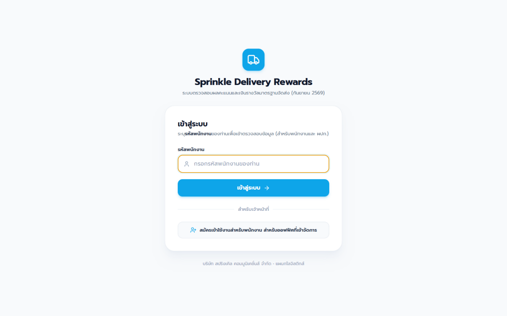
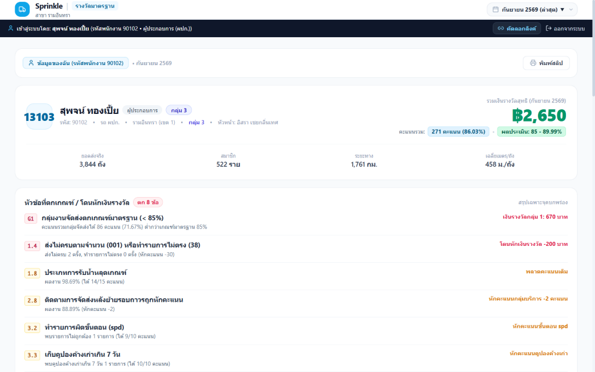
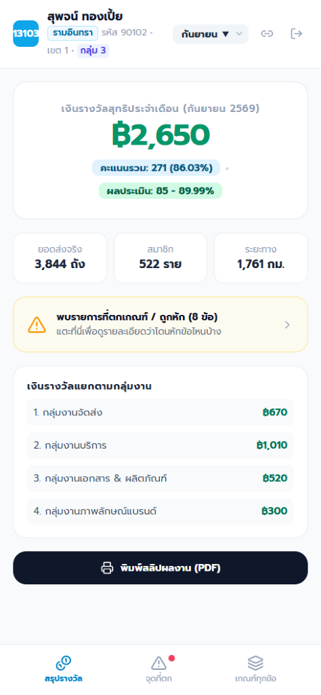
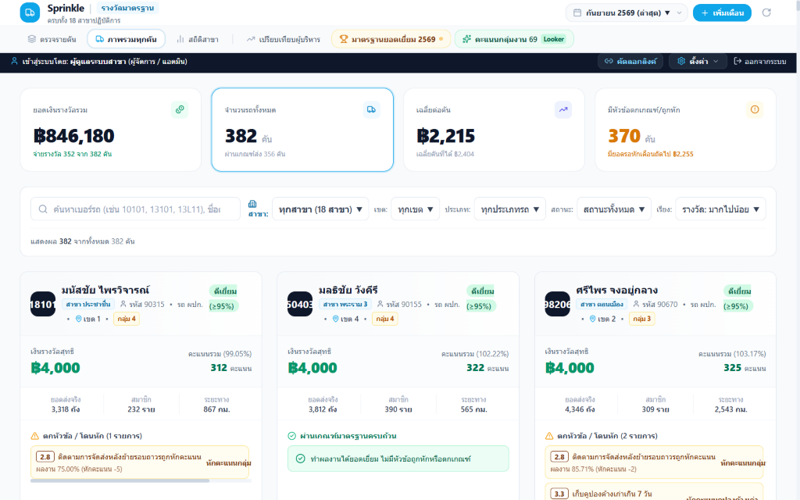
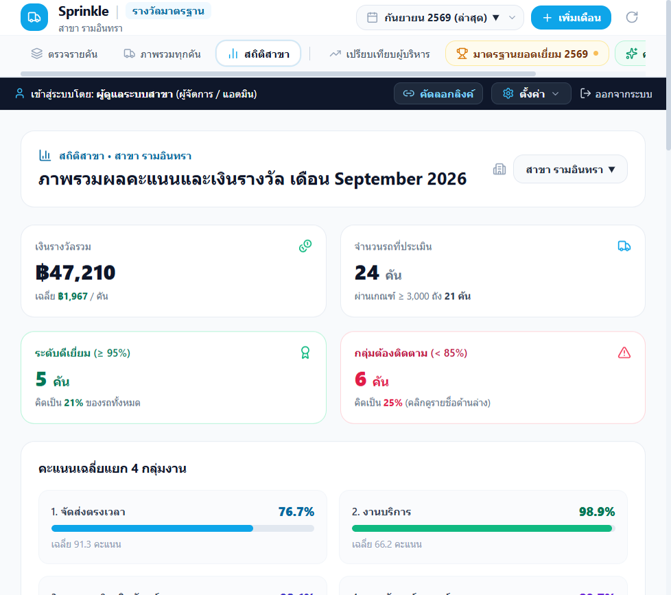
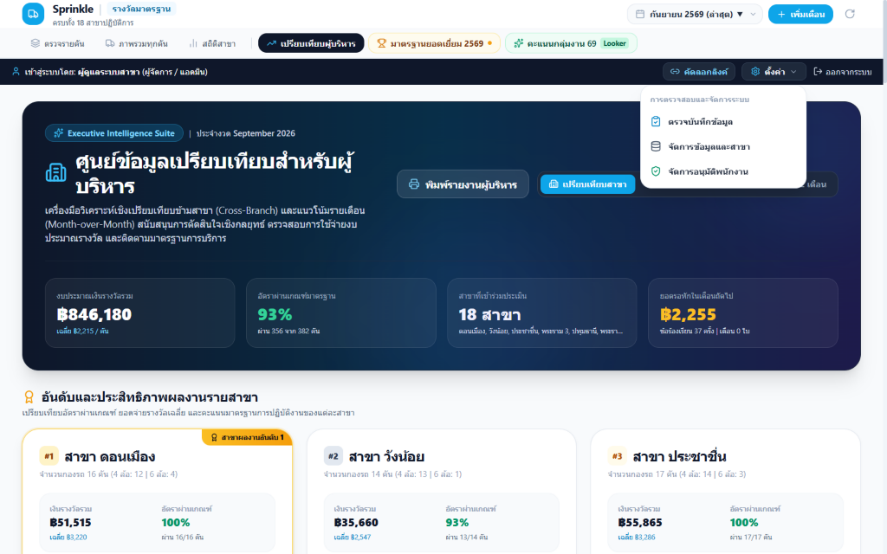

# คู่มือการใช้งานระบบ Sprinkle Delivery Rewards

ระบบตรวจสอบผลคะแนนและเงินรางวัลมาตรฐานจัดส่ง Sprinkle สำหรับพนักงานขับรถ ผู้ประกอบการ (ผปก.) หัวหน้างาน เจ้าหน้าที่ออฟฟิศ และผู้บริหาร

- **ลิงค์เข้าใช้งาน:** `https://sprinkle-rewards.vercel.app/`
- **อุปกรณ์ที่รองรับ:** คอมพิวเตอร์ (Desktop) และสมาร์ทโฟน (Mobile Responsive)

---

## 1. สิทธิ์การใช้งานแต่ละตำแหน่ง

ระบบแยกสิทธิ์การมองเห็นข้อมูลตามตำแหน่งโดยอัตโนมัติ:

| ตำแหน่ง / บทบาท | วิธีการเข้าสู่ระบบ | สิทธิ์การดูข้อมูลและเมนู |
| --- | --- | --- |
| **พนักงานขับรถ / ผู้ประกอบการ (ผปก.)** | กรอก **รหัสพนักงาน** | ดูได้ **เฉพาะข้อมูลรถของตนเอง** (เลือกดูย้อนหลังได้ทุกเดือน พิมพ์สลิป และคัดลอกลิงค์ได้) — *ไม่เห็นรถคันอื่นและเมนูผู้บริหาร* |
| **หัวหน้างาน (โลจิสติกส์ / ธุรการ)** | กรอก **รหัสพนักงาน** | ดูได้ครบทั้งสาขาและทุกแท็บรายงาน (`ตรวจรายคัน`, `ภาพรวมทุกคัน`, `สถิติสาขา`, `เปรียบเทียบผู้บริหาร`, `มาตรฐานยอดเยี่ยม 2569`, `คะแนนกลุ่มงาน 69 Looker`, และ `ตั้งค่า`) |
| **เจ้าหน้าที่ออฟฟิศ** | สมัครใช้งานและรอแอดมินอนุมัติ จากนั้นกรอก **รหัสพนักงาน** | เข้าใช้งานเมนูจัดการและรายงานได้ครบเช่นเดียวกับหัวหน้างาน |
| **ผู้ดูแลระบบ (Admin)** | กรอก `admin` และยืนยันรหัสผ่าน | เข้าถึงทุกเมนู รวมถึงอนุมัติบัญชีเจ้าหน้าที่ออฟฟิศ จัดการฐานข้อมูล และซิงค์ Google Sheets |

---

## 2. การเข้าสู่ระบบ

1. เปิดเว็บไซต์ `https://sprinkle-rewards.vercel.app/`
2. กรอก **รหัสพนักงาน** ของท่านลงในช่องกรอก *(ใช้รหัสพนักงานเท่านั้น ไม่ต้องใช้เบอร์รถ)* แล้วกดปุ่ม **เข้าสู่ระบบ**
3. **สำหรับเจ้าหน้าที่ออฟฟิศที่ยังไม่มีสิทธิ์เข้าจัดการ:** กดปุ่ม **สมัครเข้าใช้งานสำหรับพนักงาน สำหรับออฟฟิศที่เข้าจัดการ** เพื่อส่งคำขอให้แอดมินอนุมัติ

> [!TIP]
> หากได้รับ **ลิงค์หน้าเฉพาะ** จากหัวหน้างานหรือเพื่อนร่วมงาน (เช่น ลิงค์ของเดือนหรือหน้าสถิติ) สามารถกดเข้าสู่ระบบตามปกติ แล้วระบบจะพาไปยังหน้าที่ถูกส่งต่อมาให้โดยอัตโนมัติทันที

---

## 3. คู่มือสำหรับพนักงานขับรถ และ ผปก.

### 3.1 การใช้งานบนคอมพิวเตอร์ (Desktop)

เมื่อเข้าสู่ระบบด้วยรหัสพนักงานแล้ว ระบบจะแสดงหน้า **ข้อมูลของฉัน** เฉพาะรถที่ผูกกับรหัสพนักงานของท่านเท่านั้น:

**ส่วนประกอบหลักบนหน้าจอ:**
1. **แถบด้านบน:**
   - **ตัวเลือกเดือน** (มุมขวาบน): ใช้สลับดูผลคะแนนย้อนหลังและเดือนล่าสุด
   - **ปุ่มคัดลอกลิงค์**: คัดลอก URL ของเดือนและคันปัจจุบันเพื่อส่งต่อหรือเปิดดูซ้ำได้ทันที
   - **ปุ่มออกจากระบบ**: ออกจากบัญชีเมื่อใช้งานเสร็จ (แนะนำให้กดทุกครั้งหากใช้เครื่องร่วมกับผู้อื่น)
2. **การ์ดสรุปผลงานรายคัน:** แสดงเบอร์รถ, ชื่อ-ตำแหน่ง, สาขา/เขต/กลุ่ม, **รวมเงินรางวัลสุทธิ**, คะแนนรวม (พร้อมเปอร์เซ็นต์และระดับผลประเมิน), และสถิติส่งน้ำ (`ยอดส่งจริง`, `สมาชิก`, `ระยะทาง`, `เฉลี่ยเมตร/ถัง`)
3. **ปุ่มพิมพ์สลิป:** กดเพื่อออกใบสรุปผลการประเมินและเงินรางวัลเป็น PDF / กระดาษ
4. **หัวข้อที่ตกเกณฑ์ / โดนหักเงินรางวัล:** สรุปรายการที่มีคะแนนหักหรือพลาดเกณฑ์ในเดือนนั้น พร้อมจำนวนเงินที่ถูกหักหรือเงินรางวัลที่พลาด

> [!NOTE]
> หากผู้ประกอบการมีรถในความดูแล **มากกว่า 1 คัน** ภายใต้รหัสพนักงานเดียวกัน จะมีรายชื่อรถเฉพาะของตนเองให้กดสลับดูได้ (ไม่สามารถดูรถของผู้อื่นได้)

---

### 3.2 การใช้งานบนมือถือ (Mobile)

เมื่อเปิดผ่านสมาร์ทโฟน หน้าจอจะปรับเป็นรูปแบบมือถือโดยอัตโนมัติ:

- **แถบหัวด้านบน:** แสดงเบอร์รถ, ชื่อ, สาขา, รหัสพนักงาน, **ตัวเลือกเดือน**, ไอคอน **คัดลอกลิงค์**, และไอคอน **ออกจากระบบ**
- **แถบเมนูด้านล่าง (3 แท็บ):**
  1. **สรุปรางวัล** — แสดงยอดเงินรางวัลสุทธิ, ยอดส่งจริง/สมาชิก/ระยะทาง, กล่องแจ้งเตือนจำนวนข้อที่ตกเกณฑ์, ยอดแยกตาม 4 กลุ่มงาน, และปุ่ม **พิมพ์สลิปผลงาน (PDF)**
  2. **จุดที่ตก** — แสดงเฉพาะรายการที่ตกเกณฑ์หรือถูกหักเงินรางวัลแบบอ่านง่าย
  3. **เกณฑ์ทุกข้อ** — กดเปิดดูคะแนนรายข้อครบทั้ง 4 กลุ่มงาน (`1. กลุ่มงานจัดส่ง`, `2. กลุ่มงานบริการ`, `3. กลุ่มงานเอกสาร & ผลิตภัณฑ์`, `4. ภาพลักษณ์แบรนด์`)

---

## 4. คู่มือสำหรับหัวหน้างาน เจ้าหน้าที่ออฟฟิศ และแอดมิน

ผู้ใช้งานระดับจัดการจะเห็นแถบเมนูหลักครบทุกหน้า พร้อมการ์ดสรุปภาพรวมและการจัดการระบบ:

### 4.1 ตรวจรายคัน
- ใช้ตรวจสลิปรายละเอียดของรถทุกคันในทุกสาขา มีรายชื่อรถด้านซ้ายมือให้ค้นหา กรองสาขา/เขต/กลุ่ม และปุ่ม **ก่อนหน้า / ถัดไป** ด้านบน

### 4.2 ภาพรวมทุกคัน
ใช้ดูภาพรวมทั้งบริษัทหรือกรองเฉพาะสาขาแบบการ์ดหรือตาราง:

- **การ์ด KPI 4 ช่อง:** `ยอดเงินรางวัลรวม`, `จำนวนรถทั้งหมด`, `เฉลี่ยต่อคัน`, `มีหัวข้อตกเกณฑ์/ถูกหัก` (คลิกที่การ์ดเพื่อกรองดูรายการที่เกี่ยวข้องได้)
- **แถบค้นหาและตัวกรอง:** ค้นหาจากเบอร์รถ/ชื่อ/รหัสพนักงาน, กรอง **สาขา (18 สาขา)**, **เขต**, **ประเภทรถ**, **สถานะ** และเลือก **การเรียงลำดับ**
- คลิกที่การ์ดรถคันใดก็ได้เพื่อเปิดดูรายละเอียดเจาะลึกในหน้า `ตรวจรายคัน`

---

### 4.3 สถิติสาขา
วิเคราะห์ผลงานระดับภาพรวมทั้งบริษัท หรือเจาะลึกเฉพาะสาขาที่เลือก:

- **ตัวเลือกสาขามุมขวาบน:** สลับดู **ทุกสาขา (18 สาขา)** หรือเลือกเจาะจง **รายสาขา** (ค่าที่เลือกจะถูกบันทึกลงลิงค์ URL เพื่อแชร์ต่อได้ทันที)
- **KPI 4 ช่อง:** `เงินรางวัลรวม`, `จำนวนรถที่ประเมิน`, `ระดับดีเยี่ยม (≥ 95%)`, `กลุ่มต้องติดตาม (< 85%)`
- **คะแนนเฉลี่ยแยก 4 กลุ่มงาน:** แสดงเปอร์เซ็นต์และคะแนนเฉลี่ยของกลุ่มงาน 1–4
- **ส่วนวิเคราะห์ด้านล่าง:** ระดับผลการประเมิน, ตารางสรุปแยกตามสาขา/เขต, **Top 5 จุดบกพร่องที่พบบ่อย** (กด `ดู N คัน` เพื่อกางดูรายชื่อรถและคลิกเข้าไปตรวจรายคันได้), และอันดับ Top 10 / กลุ่มเสี่ยง

---

### 4.4 เปรียบเทียบผู้บริหาร และ เมนูตั้งค่า
ใช้เปรียบเทียบผลงานข้ามสาขา แนวโน้มรายเดือน และจัดการระบบทั้งหมด:

**แท็บย่อยในหน้า `เปรียบเทียบผู้บริหาร`:**
1. **เปรียบเทียบสาขา** — จัดอันดับสาขาผลงานดีเด่น อัตราผ่านเกณฑ์ เงินรางวัลเฉลี่ย และดัชนีประสิทธิภาพ
2. **แนวโน้มรายเดือน (Trend)** — ดูพัฒนาการย้อนหลังหลายเดือน (เลือกดูรวมทุกสาขาหรือกรองเฉพาะสาขาได้)
3. **เปรียบเทียบข้ามเดือน (Head-to-Head)** — เลือก 2 เดือนมาเทียบตัวเลขกันโดยตรง

**เมนู `ตั้งค่า` (มุมขวาบนของแถบสีเข้ม):**
- **ตรวจบันทึกข้อมูล:** ตรวจสอบสถานะการส่งข้อมูลครบทั้ง 18 สาขาในเดือนปัจจุบันและตารางย้อนหลังทุกเดือน
- **จัดการข้อมูลและสาขา:** ซิงค์ข้อมูลจาก Google Sheets ล่าสุด, จัดการรายเดือน, รีเซ็ตแคช, และตั้งค่าความปลอดภัย
- **จัดการอนุมัติพนักงาน:** ตรวจสอบ อนุมัติ หรือปฏิเสธคำขอเข้าใช้งานของเจ้าหน้าที่ออฟฟิศ (แสดงตัวเลขแจ้งเตือนสีเหลืองเมื่อมีคำขอรอตรวจ)

---

### 4.5 เมนูรายงานพิเศษ & การอัปเดตข้อมูลรายเดือน
- **มาตรฐานยอดเยี่ยม 2569:** ตารางสรุปผู้ที่มีสิทธิ์และผลงานสะสมยอดเยี่ยมประจำปี 2569
- **คะแนนกลุ่มงาน 69 Looker:** ข้อมูลผลคะแนนแยกกลุ่มงานรายบุคคลจากแผ่นงาน Looker 69 พร้อมตัวกรองเดือน/สาขา/สถานะและค้นหา
- **ปุ่ม `+ เพิ่มเดือน` และไอคอนซิงค์ (มุมขวาบน):**
  - ระบบจะตรวจจับแผ่นงานเดือนใหม่ใน Google Sheets (เช่น `10-2569` ถึง `12-2569`) และอัปเดตให้อัตโนมัติเมื่อเปิดใช้งาน
  - หรือกดปุ่ม **ซิงค์ (วงกลมลูกศร)** เพื่อดึงข้อมูลล่าสุดด้วยตนเอง และปุ่ม **`+ เพิ่มเดือน`** เพื่อนำเข้าไฟล์ CSV/XLSX เพิ่มเติม

---

## 5. การใช้งานระบบคัดลอกลิงค์เฉพาะหน้า (Deep-Linking)

ระบบรองรับการส่งลิงค์ให้เพื่อนร่วมงานเปิดตรงหน้าที่ต้องการได้ทันที โดยไม่ต้องกลับไปหน้าแรก:

1. เปิดไปยัง **แท็บ, เดือน, สาขา หรือเบอร์รถ** ที่ต้องการส่งต่อ
2. กดปุ่ม **คัดลอกลิงค์** บนแถบด้านบน (หรือไอคอนลิงค์บนมือถือ) จนขึ้นข้อความว่า **`คัดลอกลิงค์หน้านี้เรียบร้อยแล้ว`**
3. นำไปวางส่งใน LINE หรือแชทให้ทีมงานได้ทันที

**ตัวอย่างรูปแบบลิงค์:**
- ลิงค์หน้าสถิติเฉพาะสาขารามอินทรา เดือนกันยายน 2569:  
  `https://sprinkle-rewards.vercel.app/?tab=analytics&month=2569-09&branch=รามอินทรา`
- ลิงค์สลิปรถเบอร์ `13103` เดือนกันยายน 2569:  
  `https://sprinkle-rewards.vercel.app/?tab=single&month=2569-09&car=13103`

> [!IMPORTANT]
> **ความปลอดภัยเมื่อส่งลิงค์:** หากส่งลิงค์หน้าผู้บริหารหรือเบอร์รถของคนอื่นไปให้ผู้ประกอบการ (ผปก.) หรือพนักงานขับรถ เมื่อผู้รับล็อกอินด้วยรหัสพนักงานของตนเอง ระบบจะบล็อกหน้าหวงห้ามและปรับลิงค์กลับมาแสดง **เฉพาะข้อมูลรถของตนเอง** โดยอัตโนมัติ ไม่สามารถเปิดดูข้อมูลข้ามคนหรือข้ามสิทธิ์ได้
